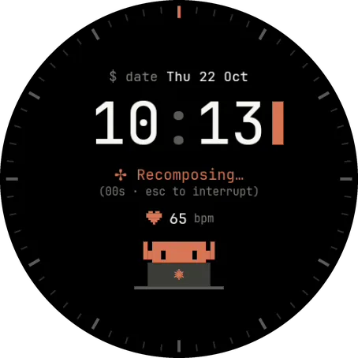
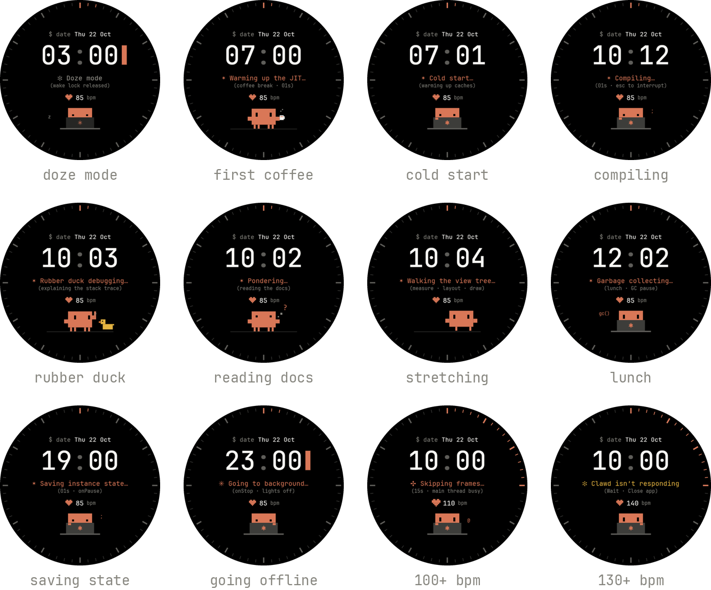
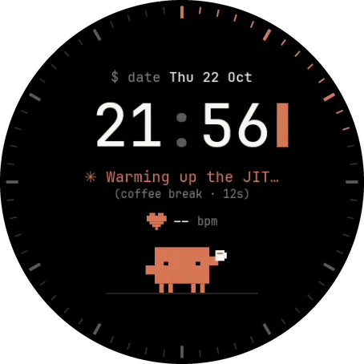
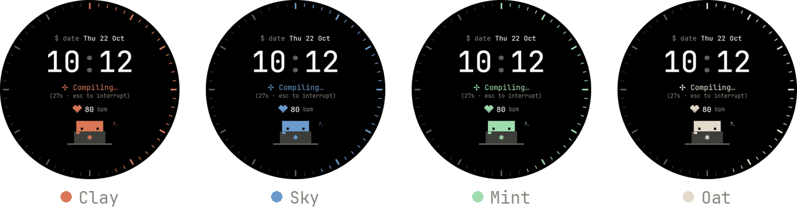
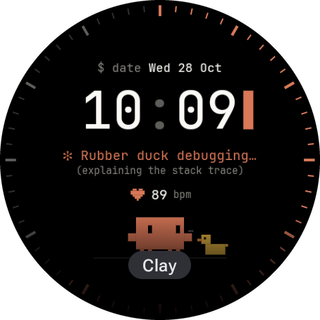
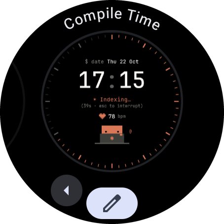
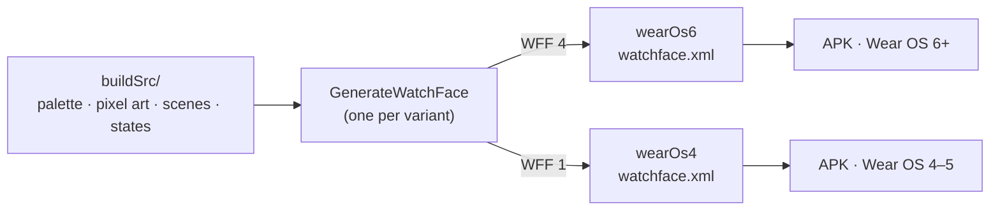

<p align="center">
  
</p>

<h1 align="center">Compile Time</h1>

<p align="center">
  A Wear OS watch face where a tiny pixel coder works through your day.<br>
  <code>✻ Compiling… (esc to interrupt)</code>
</p>

<p align="center">
  <a href="https://github.com/KadirOzturkk/compile-time-watchface/actions/workflows/build.yml"></a>
  <a href="https://github.com/KadirOzturkk/compile-time-watchface/releases/latest"></a>
  
  <a href="LICENSE"></a>
</p>

<p align="center">
  <a href="https://github.com/KadirOzturkk/compile-time-watchface/releases/latest"><b>Download</b></a> ·
  <a href="#install">Install</a> ·
  <a href="#customize">Customize</a> ·
  <a href="#how-it-works">How it works</a>
</p>

---

Your watch shows the time like a terminal does: `$ date`, a big monospace clock and a cursor that blinks once a
second. Under it lives Clawd, a small pixel coder who follows your day. Clawd types through the afternoon, takes a
coffee break, explains a stack trace to a rubber duck, goes for lunch (garbage collection, naturally) and dozes
off at night. When your heart rate climbs, the main thread starts skipping frames. Past 130 bpm, Clawd stops
responding.

- **Terminal clock** in JetBrains Mono, with the minute ticks lighting up one by one as the seconds pass.
- **A pixel heart** that beats at your real heart rate.
- **Nine moods** picked from the time of day and your heart rate, with twelve rotating work verbs
  (`Recomposing…`, `Shrinking with R8…`, `Syncing Gradle…` and friends).
- **Scenes that change every minute**: at the laptop, reading the docs, rubber duck, a little walk, coffee. They
  fade into each other on the minute, and Clawd always starts and ends a scene in the same spot.
- **A calm always-on mode**: the same layout, dimmed in place. On Wear OS 6 it cross-fades instead of snapping.
- **Four accents**: Clay, Sky, Mint and Oat.
- **No code at all**. It is a [Watch Face Format](https://developer.android.com/training/wearables/wff) face, so the
  APK holds only resources and the watch's own renderer draws it.

## A day with Clawd

<p align="center">
  
</p>

The face checks these from the top and shows the first one that matches:

| When | Status line | What Clawd does |
|---|---|---|
| Heart rate 130+ | `✻ Clawd isn’t responding` | Freezes at the keyboard. Relatable. |
| Heart rate 100+ | `Skipping frames…` | Types as fast as possible |
| Before 06:00 | `✻ Doze mode` | Sleeps on the laptop, `z` `Z` |
| Heart rate under 55 | `✻ App Standby` | Rests: reads, sips coffee, types slowly |
| 06:00 to 09:00 | `Cold start…` | Coffee, the laptop, a bit of reading |
| 12:00 to 13:00 | `Garbage collecting…` | A walk, a coffee, then `gc()` at the laptop |
| 09:00 to 18:00 | `Compiling…` and 11 other verbs | Works, with breaks for the duck, the docs, a walk and coffee |
| 18:00 to 22:00 | `Saving instance state…` | Wraps up the day |
| After 22:00 | `Going to background…` | Winds down |

Scenes are chosen from the clock (`(hour × 60 + minute) mod n`), so waking the screen never restarts one, and a
calm glance at 10:03 finds Clawd talking to the rubber duck. 🦆 During work hours the order tells a small story:
two minutes of typing, stuck, reading the docs, explaining it to the duck, a walk to clear the head, a coffee, and
back to the keyboard.

## Always on

<p align="center">
  
</p>

Always-on mode keeps the clock, the date, today's status and a dimmed Clawd, laid out on the same coordinates as
the live face, so the screen dims in place instead of rearranging. The cursor becomes an outline. On Wear OS 6
the two layers cross-fade; on Wear OS 4 and 5 the switch is instant. (The recording comes from an emulator, which has no heart-rate sensor, hence the `--`.)

## Customize

<p align="center">
  
</p>

Touch and hold the watch face, tap the edit button and pick an **Accent**. The accent colours the seconds ring,
the heart, the status line and Clawd.

<p align="center">
  
</p>

## Install

Compile Time is not on Google Play. You install it from
[Releases](https://github.com/KadirOzturkk/compile-time-watchface/releases/latest) with a free sideloading app on
your phone, or with `adb` from a computer. It takes about five minutes the first time.

### Which file?

| Your watch runs | Download | Notes |
|---|---|---|
| Wear OS 6 or newer | `…-wear-os-6.apk` | Galaxy Watch4 and later on One UI 8 Watch, Pixel Watch 2, 3 and 4 |
| Wear OS 4 or 5 | `…-wear-os-4.apk` | Pixel Watch (first gen), OnePlus Watch 2 and 3, TicWatch Pro 5 and others |
| Wear OS 3 or older | not supported | Watch Face Format needs Wear OS 4 |

To find your version, open **Settings › About watch › Software information** on a Galaxy Watch, or
**Settings › System › About › Versions** on a Pixel Watch. Not sure? The Wear OS 4 file runs on newer watches
too; you only miss the always-on cross-fade.

### 1. Turn on wireless debugging on the watch

1. Open **Developer options**. On a Galaxy Watch, tap **Software version** five times under
   *About watch › Software information*. On a Pixel Watch, tap **Build number** seven times under
   *System › About › Versions*.
2. In **Settings › Developer options**, turn on **ADB debugging** and **Wireless debugging**.
3. Put the watch on the same Wi-Fi as your phone or computer. Galaxy watches prefer Bluetooth, so turn Bluetooth
   off on the watch for a moment to keep it on Wi-Fi.
4. Open **Wireless debugging › Pair new device**. The watch shows an IP address, a pairing port and a six-digit code.

### 2a. Install from your phone

Install one of these from Google Play: **Wear Installer 2**, **Bugjaeger Mobile ADB** or **GeminiMan WearOS
Manager**. Pair it with the IP address, pairing port and code from the watch, then connect using the port shown on
the main **Wireless debugging** screen (it is not the pairing port). Pick the APK you downloaded and install it.

### 2b. Install from a computer

You need [platform tools](https://developer.android.com/tools/releases/platform-tools) (`adb` 30 or newer).

```sh
adb pair 192.168.1.42:41235          # pairing port, then type the six-digit code
adb connect 192.168.1.42:38567       # the port on the main Wireless debugging screen
adb install compile-time-1.0.0-wear-os-6.apk
```

### 3. Pick the face

Touch and hold the current watch face, swipe to the end, tap **Add new** (**Add watch face** on some watches) and
choose **Compile Time**.

<p align="center">
  
</p>

When you are done, turn **ADB debugging** off again.

### Updating

Install the new APK the same way. It replaces the old one and keeps your accent. Every release is signed with the
same key, whose SHA-256 fingerprint is printed in each release's notes.

### If something goes wrong

| You see | Fix |
|---|---|
| `INSTALL_FAILED_OLDER_SDK` | That file needs a newer Wear OS. Use the `wear-os-4` file. |
| `INSTALL_FAILED_VERSION_DOWNGRADE` | The `wear-os-6` build is already installed, and the `wear-os-4` file counts as older. Keep the `wear-os-6` one, or uninstall it first. |
| `INSTALL_FAILED_UPDATE_INCOMPATIBLE` | A copy signed with a different key is installed, such as one you built yourself. Uninstall it first: `adb uninstall dev.kadirozturk.watchface.compiletime` |
| The phone app cannot connect | Use the same Wi-Fi network (not a guest network), keep Bluetooth off on Galaxy watches, and check you used the connect port, not the pairing port. Ports change when wireless debugging restarts. |
| The connection drops a few seconds after the watch screen goes dark | The watch sleeps when its screen is off and takes wireless debugging with it. Tap the screen to wake it, and keep it awake until the install finishes. |
| `-- bpm` | The watch has no heart-rate reading yet. Check that continuous heart-rate measurement is on, and allow heart-rate access if the watch asks. |

## How it works

The whole face is one `watchface.xml` in Google's [Watch Face Format](https://developer.android.com/training/wearables/wff):
shapes, texts, transforms and expressions such as `[HEART_RATE]` or `[SECOND_MILLISECOND]`, rendered by the
watch's system watch face runtime. The APK declares `android:hasCode="false"` and ships no dex.

That XML is about 200 KB of nested conditions, so nobody writes it by hand. Kotlin code in `buildSrc` builds it
during the Gradle build:



- **Two flavors, one design.** A watch refuses a face that declares a newer format than its runtime supports, and
  one APK cannot carry two versions. So `wearOs6` declares Watch Face Format 4 (minSdk 36) and `wearOs4` declares
  format 1 (minSdk 33). They differ only in how they enter always-on mode, since format 1 has no transition
  timing. `wearOs6` has the higher version code, so it installs over `wearOs4` as an update.
- **Animation at 4 fps.** Clawd's typing, blinking and walking, the spinner and the floating `{ }` `</>` `?.`
  glyphs all read `floor([SECOND_MILLISECOND] * 4)`. The heart scales with a phase computed from your heart rate.
- **Moods and scenes** are nested `Condition` blocks: the outer one picks a mood from heart rate and hour, and the
  inner one rotates scenes by the minute. A black curtain above them closes for 0.4 s on each side of a minute in
  which the scene can change, so a switch fades instead of cutting, while the clock and the heart stay put.
- **Checked before Play would.** CI validates each XML against its format's schema and each APK against Play's
  memory limits with [Google's validators](https://github.com/google/watchface), built from a pinned commit.

## Build from source

You need JDK 17 or newer and the Android SDK with platform 36. The first `validate.sh` run builds Google's
validators from source, which needs JDK 17 to 22.

```sh
./gradlew assembleRelease          # APKs in watchface/build/outputs/apk/<flavor>/release/
bash scripts/validate.sh           # schema, memory footprint and no-code checks
```

Without a `keystore.properties`, release builds are signed with your debug key. That is fine for your own
watch; to switch to an official release later, uninstall your build first. To sign with your own key, create
`keystore.properties` in the project root:

```properties
storeFile=/path/to/your.jks
storePassword=…
keyAlias=…
keyPassword=…
```

To try a change on an emulator, start a Wear OS AVD and run
`bash scripts/emulator-smoke.sh <apk> <screenshot-dir>`. It installs the face, makes it active and saves a live
and an always-on screenshot. It fails if the watch face runtime rejects the package or logs an error.

<details>
<summary>Project layout</summary>

```
buildSrc/src/main/kotlin/
  GenerateWatchFace.kt         Gradle task that writes raw/watchface.xml
  watchface/
    WatchFaceDocument.kt       live and always-on layers, ticks, cross-fade timing
    States.kt                  the nine moods, their texts and scene rotation
    Scenes.kt                  laptop, coffee, rubber duck, docs and walk scenes
    Clawd.kt                   pixel art: poses, eyes, spark, heart, props
    Markup.kt, Palette.kt      XML helpers, colours, fonts, data sources
watchface/
  build.gradle.kts             flavors, signing, generated res wiring
  src/main/                    manifest, fonts, strings, picker preview
scripts/
  validate.sh                  Google's validators, built from a pinned commit
  emulator-smoke.sh            install, activate, screenshot, check runtime logs
.github/workflows/             build on every push, publish on every v* tag
```

</details>

<details>
<summary>Tested on</summary>

| Device | Wear OS | File | Result |
|---|---|---|---|
| Emulator, large round (454 px) | 4 (API 33) | `wear-os-4` | live, always-on, heart rate, every scene, scene change while always-on |
| Emulator, large round | 5 (API 34) | `wear-os-4` | live, always-on |
| Emulator, large round | 5.1 (API 35) | `wear-os-4` | live, always-on |
| Emulator, large and small round (454 and 384 px) | 6 (API 36) | `wear-os-6` | live, always-on, cross-fade, scene change while always-on |
| Emulator, large round | 7 (API 37) | `wear-os-6` | live, always-on, scene change while always-on |
| Galaxy Watch7 | 6 (One UI 8 Watch) | `wear-os-6` | live, always-on, accents, heart rate, scene change live and while always-on |

Emulators run Google's watch face runtime. Samsung's runtime is covered only by the Galaxy Watch7; reports from
other watches are very welcome.

</details>

## Releasing

Bump `release` and `versionName` in `watchface/build.gradle.kts`, then push a tag such as `v1.0.1`. The release
workflow checks that the tag matches `versionName`, builds and validates both flavors with the release key from
the repository secrets, and publishes both APKs with a `SHA256SUMS` file.

## Credits

- [JetBrains Mono](https://github.com/JetBrains/JetBrainsMono), under the SIL Open Font License 1.1
  ([licenses/JetBrainsMono-OFL.txt](licenses/JetBrainsMono-OFL.txt)).
- [Watch Face Format](https://developer.android.com/training/wearables/wff) by Google and Samsung, and Google's
  [watch face validators](https://github.com/google/watchface).
- Clawd, the pixel creature from Claude Code, who inspired the little coder on this face.

## License

Apache License 2.0, see [LICENSE](LICENSE). The bundled fonts keep their own license.

## Disclaimer

This is an unofficial fan project. It is not affiliated with, endorsed by or sponsored by Anthropic, Google or
Samsung. The pixel mascot is a homage to Clawd, and the not-responding status reads “✻ Clawd isn’t responding”.
